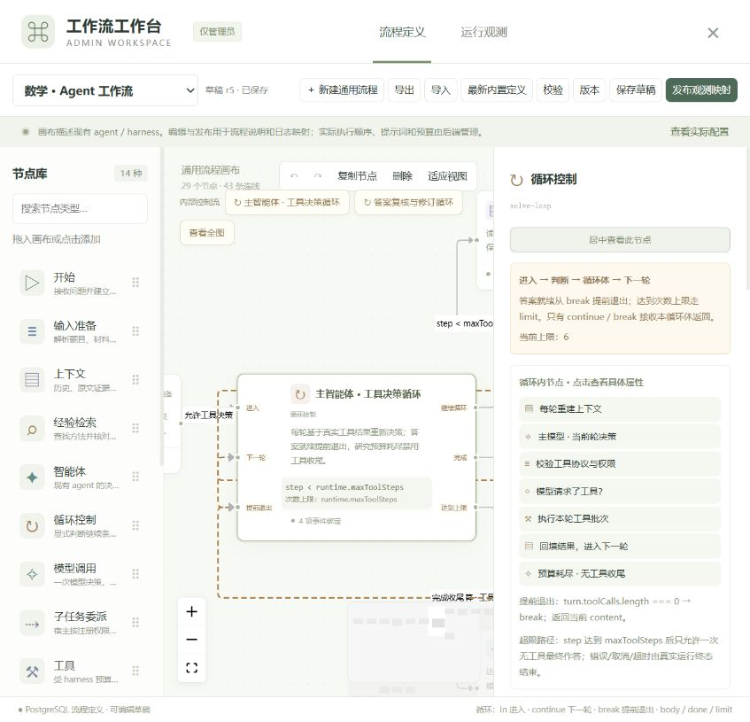
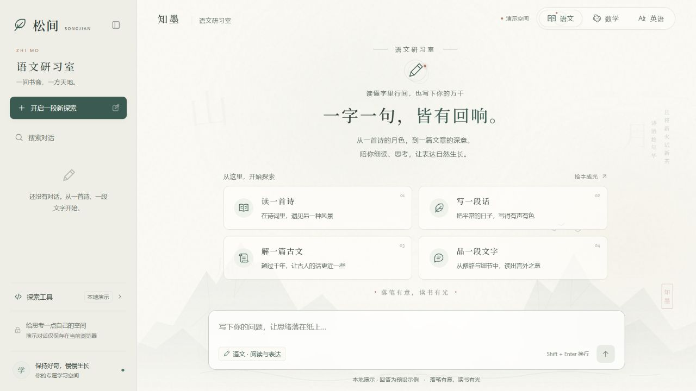
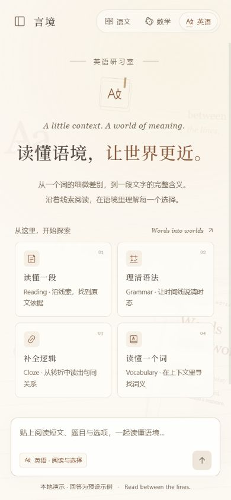

# 松间学习助手

语文、数学、英语学习页面，以及管理员工作流画布。

## 启动前端

后端启动成功后，另开 PowerShell 终端执行：

```powershell
Set-Location D:\MS\TSpj\frontend
npm ci # 首次运行需要，后续可跳过
$env:VITE_PORT = '3000'
$env:VITE_AUTH_ENABLED = 'true'
$env:VITE_CHAT_MODE = 'backend'
$env:API_PROXY_TARGET = 'http://localhost:8080'
npm run dev
```

打开 [http://localhost:3000](http://localhost:3000)，使用已有管理员账号登录，保持前后端两个终端运行。

## 查看流程图

1. 点击左侧 **工作流工作台**，选择数学、语文或英语。
2. 点击上方循环名称查看内部步骤，点击节点查看条件和属性。
3. 使用缩放、**居中查看此节点** 或 **查看全图** 调整视图。

要查看一次真实解题过程，在聊天中发送题目后，展开 **执行流程**，选择对应运行并点击 **在画布中查看**。循环节点支持按轮次查看日志。

工作流和日志仅管理员可见。退出服务时，在前后端终端分别按 `Ctrl+C`。


## UI 界面展示





